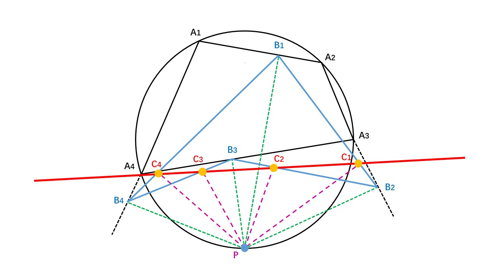

# AI-Math-Discovery
AI Math Discovery — Discover New Mathematics with AI
Exploring original mathematical theorems, conjectures, identities, and proofs with AI.
Currently, over a dozen mathematical theorems have been discovered, including the Simson-Lu Theorem, the Lu 3-Chord Identity Theorem, the Lu Double Extraction Surface Inequality, and so on.
## 1. Simson-Lu_Theorem

  <b>
    <a href="https://www.bilibili.com/video/BV1sbRKBFECa/?spm_id_from=333.1387.upload.video_card.click&vd_source=7720ff9e037156b51374d14ee8f76b51">Video </a>
    |     
    <a href="https://doi.org/10.5281/zenodo.23386090">Project Page</a>
    |
    <a href="https://github.com/langzizhixin/AI-Math-Discovery">Code</a> 
  </b>

 

## 📊 Project Poster

  
    

