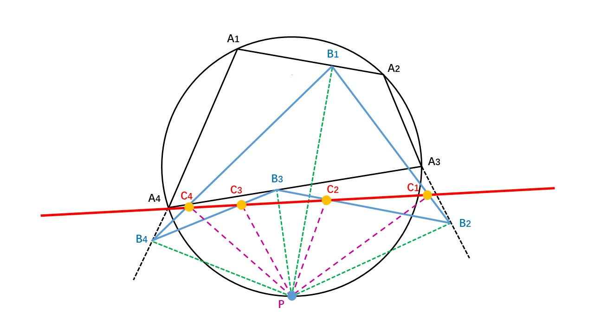
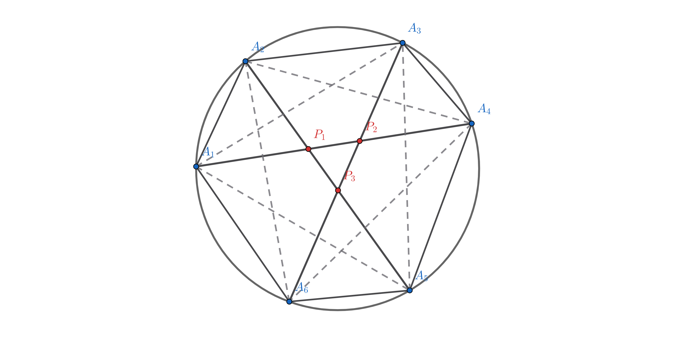

# AI-Math-Discovery
AI Math Discovery — Discover New Mathematics with AI
Exploring original mathematical theorems, conjectures, identities, and proofs with AI.
Currently, over a dozen mathematical theorems have been discovered, including the Simson-Lu Theorem, the Lu 3-Chord Identity Theorem, the Lu Double Extraction Surface Inequality, and so on.

AI数学发现——利用AI探索新的数学领域，运用AI探索原创的数学定理、猜想、恒等式和证明。目前，本人已发现十余个数学定理，包括西姆松-卢定理，卢氏三弦恒等式，卢氏不等式等等。
## 1. Simson-Lu_Theorem  

  <b>
    <a href="https://www.bilibili.com/video/BV1pNev6xEyJ/?spm_id_from=333.1387.homepage.video_card.click&vd_source=7720ff9e037156b51374d14ee8f76b51">Video </a>
    |     
    <a href="https://doi.org/10.5281/zenodo.23386090"> Paper </a>
    |
    <a href="https://github.com/langzizhixin/AI-Math-Discovery">Code</a> 
  </b>

 

  
    

Simson-Lu_Theorem：Let A₁A₂…Aₙ be n points on a circle, and let P be another point on the same circle. In each round, orthogonally project P onto the supporting lines through consecutive vertices; then repeat the operation using the lines through consecutive points of the resulting pedal polygon. The paper claims that after n−2 iterations the n resulting points are collinear, and that after n−1 iterations all n points coincide. For n=3, the statement reduces to the classical Simson–Wallace theorem.

西姆松-卢氏定理： 设 A₁A₂…Aₙ 为同一圆上的 n 个点，P 为该圆上的另一点；从 P 向相邻顶点所确定的直线依次作垂线得到第一轮垂足，再以第一轮垂足相邻点的连线为新边重复同样操作。本文证明：经过 n−2 轮垂足变换后，所得 n 个点必共线；进一步，经过 n−1 轮变换后，所得 n 个点全部重合。该结论在 n=3 时退化为经典西姆松—华莱士定理。

欧式几何历经两千多年发展，被数以万计的数学家、好者翻来覆去的研究过，所以这个领域被公认为是新定理发现的红海区。要想在这个领域发现新的，独创性的定理难度非常非常大。有幸在艰辛付出后，被我抓到一枚定理。

## 2. Lu_Three_Chord_Identities 

  <b>
    <a href="https://www.bilibili.com/video/BV1pNev6xEyJ/?spm_id_from=333.1387.homepage.video_card.click&vd_source=7720ff9e037156b51374d14ee8f76b51">Video </a>
    |     
    <a href="https://doi.org/10.5281/zenodo.23877103"> Paper </a>
    |
    <a href="https://github.com/langzizhixin/AI-Math-Discovery">Code</a> 
  </b>

 

  
    

Lu’s Three-Chord Identity：  A₁A₂·A₁A₅·P₁P₃ + A₂A₃·A₂A₆·P₁P₂  =   A₁A₂·A₂A₄·P₂P₃ + A₁A₃·A₁A₆·P₁P₂       The identity above holds (L3).

卢氏三弦定理：如图所示本人寻找到一个独创性的恒等式，  A₁A₂·A₁A₅·P₁P₃ + A₂A₃·A₂A₆·P₁P₂  =   A₁A₂·A₂A₄·P₂P₃ + A₁A₃·A₁A₆·P₁P₂ 

欧式几何历经两千多年发展，被数以万计的数学家、好者翻来覆去的研究过，所以这个领域被公认为是新定理发现的红海区。要想在这个领域发现新的，独创性的定理难度非常非常大。有幸在艰辛付出后，被我抓到第二枚定理。

